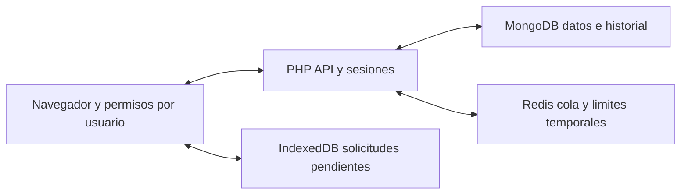
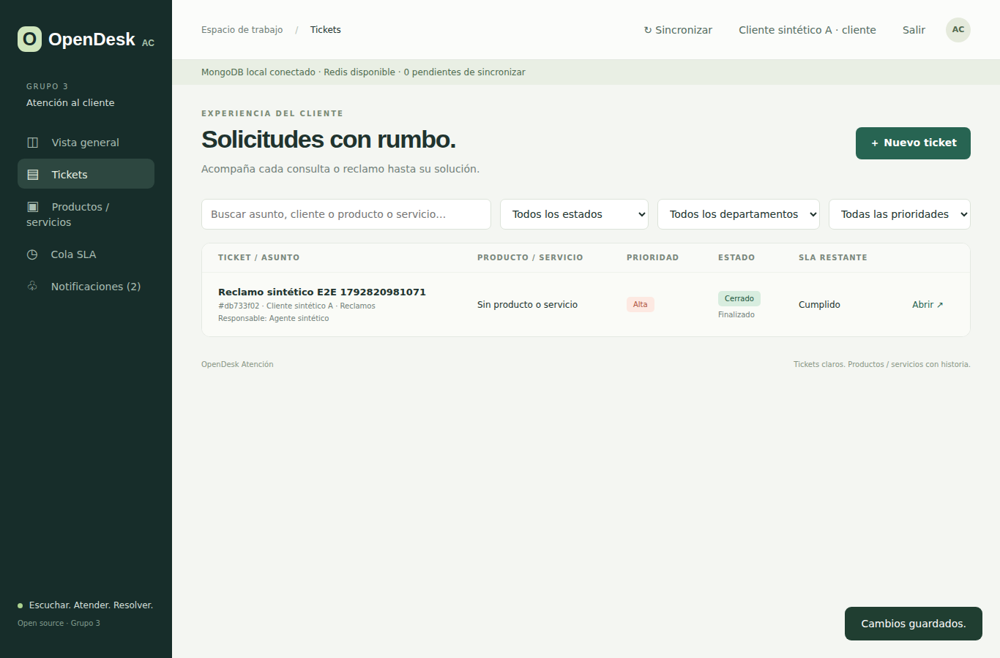
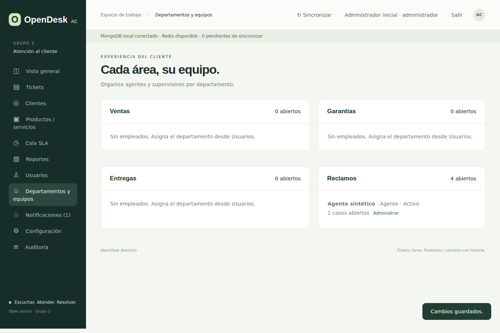
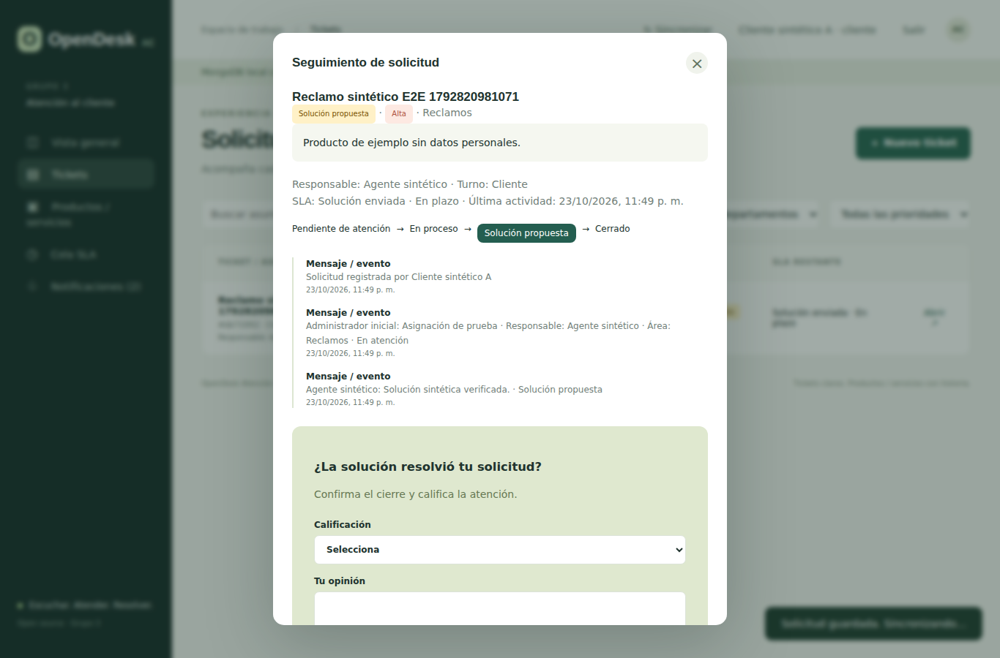

# OpenDesk Atención al Cliente

Sistema web open source en PHP para consultas, garantías, entregas, devoluciones y reclamos. Usa MongoDB para persistencia y Redis para caché. Licencia [MIT](LICENSE). Versión candidata [v0.9.0](https://github.com/vanems96/ProyectoOpenDesk/releases/tag/v0.9.0).

[Video no realizado](docs/demo/README.md) · [Presentación final borrador](docs/presentacion/OpenDesk_presentacion_S4.pptx) · [Bitácora S4](docs/seguimientos/S4.md)

## Problema y usuarios

Las solicitudes dispersas en mensajes y hojas de cálculo dificultan conservar el historial, asignar responsables y cumplir plazos. OpenDesk reúne los casos en una interfaz con seguimiento y permisos individuales.

- **Cliente:** registra solicitudes, responde, confirma una solución y valora la atención.
- **Agente:** ve y trabaja únicamente sus tickets asignados, responde y propone soluciones.
- **Supervisor:** es un agente con esa función activada en un departamento; recibe derivaciones según las reglas de SLA y conserva el acceso limitado a sus casos asignados.
- **Administrador:** gestiona usuarios, equipos, catálogo, asignaciones, reglas, reportes y auditoría. Puede cerrar con justificación.

El MVP incluye departamentos, sugerencia por menor carga, notas internas, avisos en la aplicación, satisfacción, reapertura, CSV, SLA, auditoría y registro de solicitudes pendientes en IndexedDB. Los estados visibles son Pendiente de atención, En proceso, Solución propuesta y Cerrado. Responsable y turno de respuesta se muestran por separado.

No incluye correo SMTP, SMS, adjuntos, pagos, inventario, recuperación por enlace, MFA ni calendario laboral. Las notificaciones son internas. No se utiliza SQLite.

## Arquitectura y datos



| Componente | Responsabilidad |
|---|---|
| MongoDB | Usuarios, contactos, catálogo, tickets, historial, valoraciones, reglas, auditoría y marcas de lectura |
| Redis | Cola JSON, orden en sorted set, metadata en hash, invalidación y límites de intentos |
| PHP | Autenticación, validación, API, autorización y escalamiento |
| IndexedDB | Solicitudes nuevas pendientes por usuario; no se recuperan vistas antiguas sin autorización actual |

MongoDB local y Atlas son perfiles alternativos. No hay replicación automática entre ambos. Si Redis falla, la cola consulta MongoDB; si MongoDB falla, no se simula una persistencia exitosa. La autorización se vuelve a comprobar al leer una cola cacheada.

[Arquitectura](docs/arquitectura/README.md) · [Modelo de datos](docs/modelo-datos.md) · [Mapa de claves Redis](docs/redis-claves.md) · [Decisiones](docs/decisiones.md)

## Instalación desde cero con Docker

Esta es la ruta recomendada para alguien que no haya configurado el proyecto. Solo requiere **Git, Docker y Docker Compose v2**. En Windows o macOS, iniciar Docker Desktop antes de continuar. En Linux, iniciar el servicio Docker. No hacen falta PHP, Composer ni MongoDB instalados en el equipo.

### 1 Comprobar herramientas y clonar

```bash
git --version
docker version
docker compose version
git clone https://github.com/vanems96/ProyectoOpenDesk.git
cd ProyectoOpenDesk
git checkout v0.9.0
```

Durante la preparación del release puede probarse la rama indicada en el pull request. La entrega publicada usa el tag anterior, que fija el código.

### 2 Preparar el entorno privado

Linux o macOS:

```bash
cp .env.docker.example .env
```

Windows PowerShell:

```powershell
Copy-Item .env.docker.example .env
```

Los valores de la plantilla conectan únicamente los contenedores de demostración. `.env` está excluido de Git y de la imagen. No copiar configuraciones ni credenciales de Webmin. MongoDB y Redis no publican puertos en el equipo; la aplicación se expone solo en `127.0.0.1:8080`.

### 3 Construir e iniciar

```bash
docker compose config --quiet
docker compose build app
docker compose up -d --wait app mongo redis worker
docker compose exec app php scripts/diagnose.php
```

Esperar que el diagnóstico muestre `mongo: true`, `redis: true` y las tres estructuras Redis. La primera construcción descarga imágenes y compila la extensión MongoDB. La imagen incluye PHP 8.3 y el cliente Redis socket; no requiere instalar la extensión Redis.

### 4 Esquemas y datos sintéticos

```bash
docker compose exec app php scripts/mongo-schema.php
docker compose exec app php scripts/seed.php
docker compose run --rm seed
docker compose exec app php index.php --test
```

La primera carga crea cuatro tickets `demo-ticket-*`, contactos y catálogo ficticios. La carga con **mongosh** añade cuatro tickets `mongosh-demo-ticket-*`, uno por área. Ambas se pueden repetir sin duplicar ni sobrescribir registros. No crean cuentas de empleados ni contienen contraseñas del despliegue.

### 5 Crear el primer administrador

Generar un hash escribiendo una contraseña propia de al menos doce caracteres. No usar las contraseñas públicas de las pruebas. El comando lee una línea por entrada estándar; no se pasa la contraseña como argumento. Si la terminal muestra lo que se escribe, hacerlo en privado y sin grabar la pantalla.

```bash
docker compose exec app php scripts/password-hash.php
```

Copiar **solo el hash** que imprime y ejecutar, sustituyendo el marcador y el correo:

```bash
docker compose exec -e APP_PASSWORD_HASH='<HASH_GENERADO>' app php index.php --init-admin administrador@example.test
```

Las comillas simples conservan los signos dólar del hash tanto en Bash como en PowerShell. El correo puede ser uno elegido para la prueba. Abrir **http://127.0.0.1:8080/** e ingresar con ese correo y la contraseña original. La aplicación exige cambiarla antes de continuar. No repetir `--init-admin` si existe un administrador; crear las cuentas siguientes desde Usuarios.

### 6 Probar el flujo completo

1. Desde Usuarios, crear un agente, elegir su departamento y, si corresponde, activar Supervisor.
2. Cerrar sesión y crear una cuenta de cliente desde la pantalla de acceso.
3. Como cliente, registrar un ticket con departamento y categoría.
4. Como administrador, abrirlo, revisar la sugerencia, elegir responsable del área y guardar En proceso.
5. Como agente, cambiar la contraseña temporal, abrir su ticket, guardar una nota interna y proponer una solución pública.
6. Como cliente, revisar los avisos, confirmar la solución y calificar de uno a cinco.
7. Como administrador, consultar Reportes y descargar CSV.

El agente no ve tickets ajenos. El cliente no recibe notas internas. Los tickets sin responsable aparecen al administrador y a su cliente, no a otros agentes.

### 7 Detener y volver a iniciar

```bash
docker compose down
docker compose up -d --wait app mongo redis worker
```

El volumen `mongo_data` conserva los datos. No eliminar volúmenes si se desea mantenerlos. Redis es temporal. El worker revisa el SLA cada cinco minutos y también se evalúa al consultar tickets, cola o avisos.

### Errores frecuentes

| Síntoma | Qué revisar |
|---|---|
| No se puede conectar al daemon Docker | Iniciar Docker Desktop o el servicio Docker y repetir `docker version` |
| Falta `.env` | Copiar `.env.docker.example` antes de ejecutar Compose |
| Puerto 8080 ocupado | Cambiar `APP_PORT` en `.env`, reiniciar y abrir ese puerto |
| MongoDB tarda en iniciar | Consultar `docker compose logs mongo` y esperar el healthcheck |
| Configuración privada pendiente | Verificar `OPENDESK_PRIVATE_CONFIG=/opt/opendesk/config.php` en el entorno Docker |
| Credenciales iniciales incorrectas | Usar la contraseña original que produjo el hash; después del primer acceso usar la contraseña nueva |
| Ya existe administrador | Entrar con su cuenta; las nuevas cuentas se crean desde Usuarios |
| Redis no disponible | Consultar `docker compose logs redis`; la aplicación usa MongoDB como contingencia |
| Un agente no encuentra un ticket | Comprobar que esté activo, sea del área y tenga asignado el caso |

El entorno Docker es para desarrollo y demostración local. Un despliegue público necesita HTTPS, autenticación de motores, copias de respaldo y configuración del servidor. No publicar los puertos de MongoDB ni Redis.

## Instalación nativa y Webmin

Requiere PHP 8.2 o superior con extensión MongoDB 1.19+ o 2.x y un servidor MongoDB. Redis puede usar extensión nativa o cliente socket. No requiere Composer. Copiar `config.example.php` a una ruta privada fuera de la raíz web y establecer `OPENDESK_PRIVATE_CONFIG` con su ruta absoluta.

```bash
export OPENDESK_PRIVATE_CONFIG=/ruta/privada/config.php
php index.php --check
php scripts/diagnose.php
php scripts/mongo-schema.php
php index.php --init-admin administrador@example.test
php -S 127.0.0.1:8080
```

En PowerShell: `$env:OPENDESK_PRIVATE_CONFIG='C:/ruta/privada/config.php'`. El archivo privado configura URI, base, Redis y `accessHash`. Puede generarse el hash con `php scripts/password-hash.php`.

En Webmin la ruta privada por defecto es `/home/grupo3/.config/opendesk/config.php`. El comando siguiente exporta la aplicación completa sin secretos:

```bash
php scripts/export-webmin.php
```

Copiar solamente `dist/index.php` a la carpeta pública de OpenDesk. Mantener configuración, `.env`, `.git`, backups y herramientas de prueba fuera de `public_html`. La exportación no modifica los datos. Alternativamente, desplegar el archivo raíz `index.php` con `src/`.

La activación nativa de JSON Schema requiere permisos de MongoDB. En Webmin el usuario no tiene `collMod`: la validación PHP está activa, pero las escrituras externas no quedan protegidas por ella. No ampliar permisos para saltar esta limitación. [Detalle](docs/seguimientos/S3.md).

## Variables de entorno

`.env.example` documenta la instalación nativa y `.env.docker.example` Docker. PHP **no carga `.env` automáticamente**: Compose lo inyecta, o el usuario debe exportar las variables en el proceso PHP.

| Variable | Función |
|---|---|
| `OPENDESK_PRIVATE_CONFIG` | Ruta absoluta del archivo privado, fuera de la raíz web |
| `OPENDESK_PROFILE` | `local` o `atlas` |
| `MONGODB_URI` | URI privada del motor elegido |
| `MONGODB_DATABASE` | Base del entorno, por ejemplo `opendesk_demo` en Docker |
| `REDIS_HOST`, `REDIS_PORT` | Host y puerto del Redis del entorno |
| `REDIS_CLIENT` | `auto`, `socket` o `extension` |
| `REDIS_USERNAME`, `REDIS_PASSWORD` | ACL y contraseña privadas cuando el servidor las exige |
| `REDIS_DATABASE` | Número de base Redis autorizado |
| `REDIS_PREFIX` | Prefijo que conserva `grupo3:`, separado por entorno |
| `APP_PASSWORD_HASH` | Hash privado de la contraseña inicial; se usa al crear el primer administrador |
| `ATLAS_CONFIG_SOURCE` | Compatibilidad opcional con una configuración Atlas anterior |
| `APP_PORT` | Puerto local publicado por Docker Compose |
| `OPENDESK_TEST_DATABASE` | `yes` únicamente para ejecutar pruebas destructivas en una base aislada |
| `E2E_BASE_URL` | URL del servidor de pruebas Chromium |

Para la carga nativa con mongosh, exportar `MONGODB_URI` y `MONGODB_DATABASE` desde el archivo privado de entorno y ejecutar `mongosh --nodb --file scripts/seed-mongosh.js`. La URI se lee únicamente del entorno; el script no contiene conexiones reales.

## Capturas y demostración

Las capturas siguientes corresponden a un entorno de prueba aislado con datos sintéticos, no a cuentas reales del servidor.





El video no se realiza en esta preparación por solicitud del equipo. Se conserva como requisito pendiente del docente. [Guion y reproducción](docs/demo/README.md). [Borrador editable de presentación](docs/presentacion/OpenDesk_presentacion_S4.pptx).

## Pruebas y mediciones

```bash
php tests/roles.php
php tests/integration-tools.php
php scripts/sync-app.php --check
php scripts/measure.php 1000 5
```

Las pruebas de roles usan almacenamiento en memoria. La integración real requiere una base aislada y Redis. GitHub Actions comprueba MongoDB/Redis reales, cliente socket, flujo Chromium y una instalación Docker limpia. Nunca ejecutar pruebas de borrado o bootstrap contra producción.

[Resultados Webmin con tres operaciones y medianas](docs/mediciones/webmin-2026-10-23.md) · [Medición CI separada](docs/mediciones/ci-2026-10-22.md) · [Pruebas](docs/pruebas.md) · [Seguridad](SECURITY.md).

Las mediciones usan datos sintéticos y no equivalen a carga concurrente ni a tiempos completos de HTTP. El navegador requiere Node.js y Chromium solo para las pruebas, no para usar la aplicación.

## Estructura y trabajo del equipo

`src/` contiene componentes PHP y el archivo desplegable. `docs/` mantiene arquitectura, evidencias y seguimientos. `data/` describe los datos sintéticos. `scripts/` reúne diagnóstico, carga, esquemas y exportación. `tests/` contiene comprobaciones automatizadas.

Después de editar componentes PHP, ejecutar `php scripts/sync-app.php`. La integración se hace mediante ramas y pull requests. La excepción académica sobre aportes individuales está registrada en [S1](docs/seguimientos/S1.md); no se inventan commits de otros integrantes.

## Roadmap y entrega

[Roadmap detallado](docs/roadmap.md): en un mes, instalación externa, permisos de validadores y accesibilidad; en seis meses, correo, adjuntos y pruebas de carga; como posible graduación, evaluación de políticas de asignación y satisfacción.

[CHANGELOG](CHANGELOG.md) · [S1](docs/seguimientos/S1.md) · [S2](docs/seguimientos/S2.md) · [S3](docs/seguimientos/S3.md) · [S4](docs/seguimientos/S4.md) · [Ficha del portal](portal.yml) · [Licencia MIT](LICENSE).

La versión candidata es `v0.9.0`. La entrega final del curso será `v1.0.0`; si el grupo expone en semana 16, el docente evalúa S4 sobre esa versión final. La instalación limpia automatizada no reemplaza la [prueba por alguien que no configuró el proyecto](docs/instalacion/validacion-externa.md), que debe completarse antes de afirmar ese requisito como aprobado.
