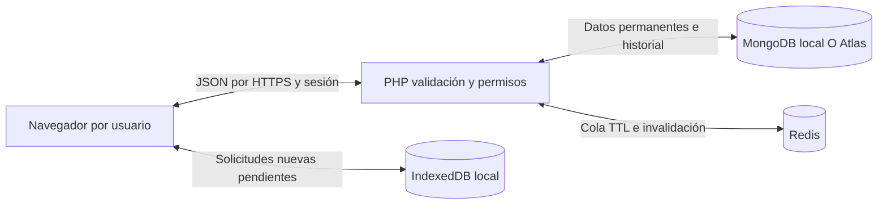
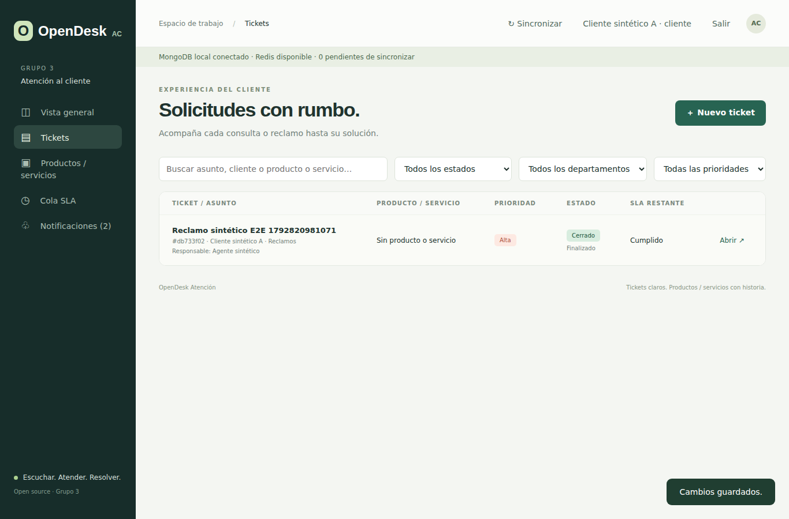
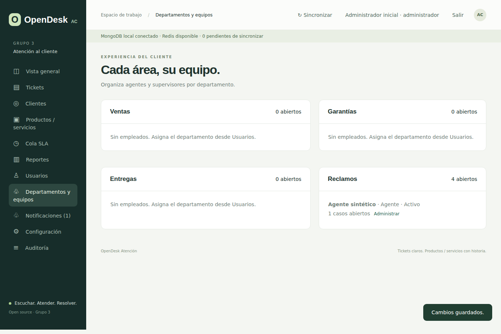
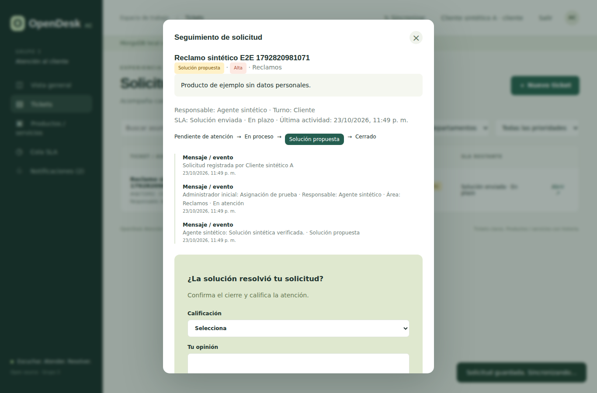

# OpenDesk Atención al Cliente

Sistema web open source para consultas, garantías, entregas, devoluciones y reclamos. Desarrollado en PHP con MongoDB como almacenamiento permanente y Redis como caché y cola priorizada. Licencia [MIT](LICENSE).

**Versión de software: [v1.0.0](https://github.com/vanems96/ProyectoOpenDesk/releases/tag/v1.0.0).**

[Aplicación desplegada](https://grupo3.crnube.org/Opendesk/) · [Presentación final](docs/presentacion/OpenDesk_exposicion_final_v1.0.0.pptx) · [Presentación PDF](docs/presentacion/OpenDesk_exposicion_final_v1.0.0.pdf) · [Matriz de entrega](docs/entrega/README.md) · [Mediciones](docs/mediciones/README.md)

El software y su documentación cierran en v1.0.0. Actualización del 04/11/2026: Joan confirmó que el video es opcional y que la instalación por otra persona ya se realizó. Por tanto, esos dos puntos dejan de figurar como pendientes. La confirmación del equipo se registra separadamente de las pruebas automatizadas; no se inventan nombre, fecha de ejecución ni capturas. [Estado y evidencias](docs/entrega/README.md).

## Problema, usuarios y alcance

Las solicitudes dispersas en mensajes y hojas de cálculo dificultan conservar el historial, asignar responsables y cumplir plazos. OpenDesk reúne cada caso y su seguimiento en una interfaz con permisos individuales.

| Usuario | Puede hacer |
|---|---|
| Cliente | Crear sus tickets, responder, revisar avisos, confirmar una solución, calificar y solicitar reapertura |
| Agente | Ver y trabajar únicamente tickets asignados, responder, guardar notas privadas y proponer una solución |
| Supervisor | Agente con función de supervisor de un departamento; recibe derivaciones por SLA y mantiene acceso a sus casos asignados |
| Administrador | Gestionar usuarios, departamentos, catálogo, clientes, asignaciones, reglas, reportes y auditoría; cerrar con motivo |

Hay **tres roles de autenticación**; supervisor es una función del agente. Las áreas son Ventas, Garantías, Entregas y Reclamos. Estados visibles: Pendiente de atención → En proceso → Solución propuesta → Cerrado. El responsable y el turno de respuesta se muestran por separado.

El MVP incluye sugerencia del agente con menos casos abiertos del área, reasignación justificada, notas internas, avisos dentro de la aplicación, valoración, reapertura, CSV, SLA de resolución, primera respuesta, auditoría y solicitudes pendientes en IndexedDB. Las fechas visibles usan dd/mm/aaaa y la zona de Costa Rica.

No incluye SMTP/SMS, adjuntos, pagos, inventario, recuperación por enlace, MFA, calendario laboral ni capacidad concurrente certificada. No usa SQLite, según el alcance acordado.

## Arquitectura y datos



MongoDB guarda usuarios, contactos, productos/servicios, tickets, historial, valoraciones, reglas, auditoría y marcas de lectura. Redis usa string, sorted set y hash, TTL de 15 s e invalidación al cambiar tickets. La cola cacheada vuelve a comprobar permisos en MongoDB. Las sesiones PHP usan el almacenamiento configurado por el servidor.

MongoDB local y Atlas son perfiles alternativos, sin replicación automática. El despliegue actual usa **MongoDB local, grupo3_db**. Si Redis falla, se consulta MongoDB; si MongoDB falla, no se anuncia una escritura exitosa. IndexedDB no reemplaza la base permanente.

[Arquitectura](docs/arquitectura/README.md) · [Modelo de datos](docs/modelo-datos.md) · [Redis y TTL](docs/redis-claves.md) · [Decisiones](docs/decisiones.md)

## Instalación desde cero para un compañero

Esta ruta crea una copia local separada. **No necesita cuentas de Webmin, URI de Atlas, PHP, Composer ni motores instalados en el equipo**. No copie archivos privados de otra instalación. Los comandos de las secciones 2 a 12 se ejecutan dentro de la carpeta `ProyectoOpenDesk`.

### 1 Preparar las herramientas

Necesita Git, Docker Engine y Docker Compose v2. En Windows puede usar [Git for Windows](https://git-scm.com/install/windows) y [Docker Desktop](https://docs.docker.com/desktop/setup/install/windows-install/). Docker Desktop incluye Compose; en Linux siga la [instalación oficial de Compose](https://docs.docker.com/compose/install/). Use contenedores Linux. En Windows, si Docker pide WSL o virtualización, complete los requisitos de su documentación oficial y reinicie si se solicita.

Abra Docker Desktop y espere que el motor esté funcionando. En Windows abra **PowerShell**; en Linux/macOS, una terminal. Ejecute una orden por vez:

```bash
git --version
docker version
docker compose version
```

**Resultado esperado:** Git devuelve su versión; Docker muestra `Client` y `Server`; Compose devuelve una versión v2 o posterior compatible. Si Docker solo muestra Client y un error de conexión, no continúe: abra el motor y repita. No use el comando antiguo `docker-compose`.

### 2 Descargar la versión fija

Elija una carpeta nueva, sin archivos anteriores de OpenDesk:

```bash
git clone https://github.com/vanems96/ProyectoOpenDesk.git
cd ProyectoOpenDesk
git checkout v1.0.0
git describe --tags --exact-match
```

**Resultado esperado:** la última orden muestra `v1.0.0`. El aviso `detached HEAD` es normal al usar una versión fija. Para instalar no hace falta crear una rama. Si la carpeta ya existe, elija otra o revise qué contiene; no borre trabajo previo.

### 3 Crear la configuración local

PowerShell:

```powershell
Copy-Item .env.docker.example .env
Get-Item .env
```

Linux/macOS:

```bash
cp .env.docker.example .env
ls -l .env
```

**Resultado esperado:** existe un archivo llamado exactamente `.env`, no `.env.txt`. La plantilla conecta MongoDB y Redis de esta copia Docker y expone la web solo en `127.0.0.1:8080`. No cambie `MONGODB_URI` por la de producción. `.env` está excluido de Git. Si ya existe una configuración propia, consérvela y compárela antes de reemplazarla.

### 4 Comprobar y construir

```bash
docker compose config --quiet
docker compose build app
```

**Resultado esperado:** la primera orden termina sin errores; la segunda construye `opendesk:local`. La primera construcción descarga imágenes y compila la extensión MongoDB: puede tardar según la conexión y el equipo. Mantenga Docker abierto y espere que vuelva el indicador de la terminal. No cerrar la ventana a mitad de la construcción.

### 5 Iniciar los servicios

```bash
docker compose up -d --wait app mongo redis worker
docker compose ps
docker compose exec app php scripts/diagnose.php
```

**Resultado esperado:** app, mongo, redis y worker están en ejecución; app/mongo/redis pasan sus controles de salud. El diagnóstico muestra `mongo: true`, `redis: true` y comprueba las estructuras Redis. El worker puede aparecer solo como `Up`, porque no tiene healthcheck propio. No instale la extensión PHP Redis: el cliente socket incluido cubre este entorno.

Si un servicio no inicia:

```bash
docker compose logs --tail=80 app mongo redis worker
```

No comparta logs que contengan configuración privada. Los comandos se deben ejecutar desde la carpeta del proyecto, donde está `compose.yaml`.

### 6 Instalar el esquema y cargar datos ficticios

```bash
docker compose exec app php scripts/mongo-schema.php
docker compose exec app php scripts/seed.php
docker compose run --rm seed
docker compose exec app php index.php --test
```

**Resultado esperado:** los esquemas e índices se instalan en el MongoDB local de Docker; la carga PHP crea cuatro tickets `demo-ticket-*`; mongosh agrega cuatro `mongosh-demo-ticket-*`. Al terminar hay **ocho tickets de ejemplo**, contactos y catálogo. El test devuelve `OK`. Los scripts se pueden repetir sin duplicar esos identificadores ni sobrescribir documentos existentes. No crean usuarios de empleados ni importan cuentas de Webmin.

En el servidor compartido de Webmin, `--schema` puede requerir permisos que su usuario no tiene. Esta restricción no aplica al MongoDB aislado de la copia Docker. [Detalle de validación](docs/seguimientos/S3.md).

### 7 Crear el primer administrador

Elija un correo de prueba y una contraseña propia de **12 a 72 bytes**. No use las contraseñas de las pruebas automatizadas ni copie las del despliegue compartido. La pantalla inicial no ofrece un administrador predeterminado.

```bash
docker compose exec app php scripts/password-hash.php
```

El programa espera una línea: escriba la contraseña y pulse Enter. **Puede verse mientras la escribe**; hágalo en privado. Copie solo el hash resultante, que comienza con `$2...`, y sustituya el marcador en esta orden:

```bash
docker compose exec -e APP_PASSWORD_HASH='<HASH_GENERADO>' app php index.php --init-admin administrador@example.test
```

Mantenga las comillas simples para conservar los signos `$`, tanto en PowerShell como en Bash. Cambie `administrador@example.test` por el correo que eligió. El hash no es la contraseña de acceso: se ingresa con la contraseña original que escribió. No ejecute `--init-admin` una segunda vez si ya existe administrador.

### 8 Abrir y entrar

Abra **http://127.0.0.1:8080/** en el navegador. Debe aparecer el logo y el formulario de OpenDesk. Ingrese con el correo de administrador que creó y la contraseña original. El primer acceso exige cambiarla por otra diferente. Conserve esa nueva contraseña para las siguientes entradas.

**Resultado esperado:** el panel informa MongoDB conectado y Redis disponible. Esta dirección es su copia local; [grupo3.crnube.org](https://grupo3.crnube.org/Opendesk/) es otro despliegue y no utiliza las cuentas que acaba de crear.

### 9 Crear las cuentas para probar los roles

Como administrador, abra **Usuarios → Nuevo usuario**. Cree un empleado de Reclamos y una contraseña temporal. Opcionalmente cree otro empleado del área y active Supervisor. El supervisor conserva el rol Agente.

Para el cliente, cierre sesión y elija **Crear cuenta de cliente**. Use un correo ficticio diferente y una contraseña propia. Para alternar las cuentas, cierre sesión o use perfiles separados del navegador. Dos pestañas del mismo perfil comparten la sesión; no sirven para tener dos usuarios distintos al mismo tiempo.

Las contraseñas temporales de los empleados deben cambiarse al entrar. Los correos se usan para identificar cuentas; el MVP no envía mensajes de verificación ni correo SMTP.

### 10 Recorrer un ticket completo

1. **Cliente:** Tickets → Nuevo ticket. Complete asunto, descripción, categoría, prioridad y departamento Reclamos; guarde. Debe aparecer Pendiente de atención.
2. **Administrador:** abra el caso y asigne al empleado activo de Reclamos. Puede consultar la sugerencia por menor carga. Guarde En proceso.
3. **Empleado:** entre con su cuenta. Debe ver el caso asignado; no verá casos ajenos. Abra el ticket, guarde una nota interna y después una respuesta pública.
4. **Cliente:** confirme que ve la respuesta pública y no ve la nota interna. Conteste si desea continuar.
5. **Empleado:** escriba una solución pública y seleccione Solución propuesta. El turno pasa al cliente; no equivale a cierre confirmado.
6. **Cliente:** confirme la solución y califique de 1 a 5. Debe aparecer Cerrado. Si no resuelve el caso, use la opción de continuar y explique el motivo.
7. **Administrador:** consulte Reportes, CSV y Auditoría. El caso cerrado no debe permanecer como abierto en la cola SLA.

Use asuntos identificados como `PRUEBA INSTALACIÓN`, sin información personal real. La calificación de prueba debe indicarse como simulada. No se requiere esperar el vencimiento de un SLA para probar el recorrido; la contingencia y las reglas se verifican además en CI aislado.

### 11 Comprobar que los datos permanecen

Anote el asunto del ticket cerrado y ejecute:

```bash
docker compose down
docker compose up -d --wait app mongo redis worker
docker compose exec app php scripts/diagnose.php
```

Entre de nuevo. Deben conservarse las cuentas y los tickets. MongoDB guarda los datos en el volumen `mongo_data`; Redis es temporal. **No agregue la opción que elimina volúmenes** si desea conservar los datos. El worker revisa SLA cada cinco minutos y la aplicación también evalúa reglas al consultar tickets, cola o avisos.

### 12 Ejecutar verificaciones adicionales

```bash
docker compose exec app php tests/roles.php
docker compose exec app php tests/integration-tools.php
docker compose exec app php scripts/sync-app.php --check
docker compose exec app php scripts/export-webmin.php
```

**Resultado esperado:** 179 comprobaciones de negocio/seguridad y 50 de herramientas, componentes sincronizados y exportación generada. Las primeras dos suites usan dobles de almacenamiento o herramientas aisladas: no son un ensayo de carga sobre sus datos. La integración con motores y navegador se ejecuta en CI con base de pruebas separada.

### 13 Registrar la instalación del compañero

Complete [validación externa](docs/instalacion/validacion-externa.md) con su nombre o identificador autorizado, fecha, sistema, versión, pasos, problemas y resultado. Anexe capturas sin contraseñas. Su firma o confirmación debe corresponder a lo que efectivamente hizo. Joan confirmó el 04/11/2026 que la instalación externa ya se realizó. El registro conserva esa confirmación; los datos no comunicados no se inventan. CI corresponde a una prueba independiente.

## Errores frecuentes

| Síntoma | Acción concreta |
|---|---|
| `git` o `docker` no se reconoce | Instalar la herramienta y abrir una terminal nueva; comprobar otra vez la sección 1 |
| No conecta con Docker / `daemon` | Abrir Docker Desktop o iniciar el servicio Docker; esperar el motor |
| Docker solicita WSL o virtualización | Seguir requisitos oficiales, habilitar la función necesaria y reiniciar si se solicita |
| No encuentra configuración Compose | Ejecutar `cd ProyectoOpenDesk`; debe existir `compose.yaml` |
| Falta `.env` | Copiar `.env.docker.example` con el nombre exacto; evitar `.env.txt` |
| Puerto 8080 ocupado | Cambiar `APP_PORT=8081` en `.env`, ejecutar otra vez `docker compose up -d --wait app mongo redis worker` y abrir `http://127.0.0.1:8081/` |
| Contenedor `unhealthy` o no termina de iniciar | Consultar `docker compose ps` y los logs de la sección 5; esperar el diagnóstico antes de crear usuarios |
| La construcción falla descargando imágenes | Revisar Internet, espacio disponible y Docker; repetir `docker compose build app` conservando el mensaje de error |
| Configuración privada pendiente | En Docker debe usarse `/opt/opendesk/config.php`; no configurar rutas de Webmin en la copia local |
| No puede iniciar sesión | Usar el correo que creó y la contraseña original; después del cambio inicial, la contraseña nueva, nunca el hash |
| Ya existe administrador | Entrar con esa cuenta; el bootstrap no restablece su contraseña |
| No puede cambiar la contraseña temporal | Usar una diferente, de al menos 12 caracteres y hasta 72 bytes; revisar el mensaje del formulario |
| Redis no disponible | Consultar logs Redis y diagnóstico. MongoDB actúa como contingencia; no vaciar todo Redis |
| Empleado no ve el ticket | Verificar cuenta activa, departamento y asignación. Un caso sin responsable no es visible para todos los empleados |
| No llega un correo | Es esperado: los avisos son internos; abrir Notificaciones |
| No aparece el logo después de exportar | Copiar también `dist/assets/`, conservando la ruta relativa junto a `index.php` |
| El compañero no ve sus cuentas en la nube | La copia local y Webmin son instalaciones distintas con bases y credenciales distintas |
| Demasiados intentos de acceso | Esperar el período indicado; no desactivar los límites para seguir probando |

## Instalación nativa y Webmin

La ruta Docker anterior es la recomendada para un compañero. Un servidor existente requiere PHP 8.2+ con extensión MongoDB compatible y acceso autorizado a MongoDB y Redis. Redis puede usar extensión o el cliente socket incluido. No requiere Composer.

1. Copiar `config.example.php` **fuera de la raíz pública** y completar allí la conexión y Redis del entorno autorizado. Conservar permisos privados. El archivo privado no se sube a Git.
2. Definir `OPENDESK_PRIVATE_CONFIG` con la ruta absoluta. En Bash: `export OPENDESK_PRIVATE_CONFIG=/ruta/privada/config.php`; en PowerShell: `$env:OPENDESK_PRIVATE_CONFIG='C:/ruta/privada/config.php'`.
3. Ejecutar `php index.php --check` y `php scripts/diagnose.php`. `redis: FALTA` en `--check` solo indica ausencia de la extensión; el diagnóstico puede confirmar que el cliente socket funciona.
4. Instalar el esquema solo si el motor y los permisos lo permiten; realizar cargas y pruebas únicamente en una base autorizada para ello. No usar comandos de instalación para reconfigurar un servidor existente.
5. En una instalación nueva, crear el administrador con el procedimiento de hash de la sección 7.
6. Exportar desde el repositorio: `php scripts/export-webmin.php`.
7. Copiar **`dist/index.php`, la carpeta `dist/assets/` y `dist/VERSION`** a la carpeta pública de OpenDesk. También puede desplegar `index.php`, `src/`, `assets/` y `VERSION` desde el repositorio, preservando la estructura.
8. Mantener `.env`, `.git`, configuración, herramientas de prueba y respaldos fuera de `public_html`. Configurar HTTPS y las sesiones según el servidor. Si se requiere evaluación de SLA sin visitas, programar `php /ruta/publica/index.php --escalate` cada cinco minutos con el entorno privado del usuario; no crear tareas de otro usuario.
9. Conservar un respaldo privado previo antes de reemplazar código y verificar login, logo, diagnóstico y un ticket sintético propio.

Webmin usa por defecto `/home/grupo3/.config/opendesk/config.php`. El paquete exportado no incluye esa configuración ni sus credenciales. El esquema PHP valida escrituras de negocio; habilitar validadores nativos en el MongoDB compartido depende de `collMod`, pendiente del administrador en [#13](https://github.com/vanems96/ProyectoOpenDesk/issues/13). No ampliar permisos para eludir esa restricción.

## Variables de entorno

PHP no carga `.env` automáticamente. Docker Compose lo inyecta; en una instalación nativa hay que exportar las variables o completar el archivo privado. Consulte [.env.example](.env.example), [.env.docker.example](.env.docker.example) y [config.example.php](config.example.php).

| Variable | Función |
|---|---|
| `OPENDESK_PRIVATE_CONFIG` | Archivo de configuración privado fuera de la raíz pública |
| `OPENDESK_PROFILE` | Perfil `local` o `atlas` |
| `MONGODB_URI`, `MONGODB_DATABASE` | Conexión y base autorizadas |
| `REDIS_HOST`, `REDIS_PORT`, `REDIS_CLIENT` | Servidor Redis y cliente auto/socket/extension |
| `REDIS_USERNAME`, `REDIS_PASSWORD`, `REDIS_DATABASE` | ACL y base de Redis si se requieren |
| `REDIS_PREFIX` | Prefijo por entorno que conserva `grupo3:` |
| `APP_PASSWORD_HASH` | Hash utilizado al crear el administrador inicial |
| `ATLAS_CONFIG_SOURCE` | Compatibilidad opcional con configuración Atlas privada anterior |
| `APP_PORT` | Puerto web local de Docker |
| `OPENDESK_TEST_DATABASE` | `yes` solo para suites explícitamente aisladas con datos descartables |
| `E2E_BASE_URL` | URL local para pruebas Chromium |
| `OD_BENCH_*` | Cuentas privadas del ensayo HTTPS; [protocolo completo](docs/mediciones/http-2026-11-03/README.md) |

La carga `scripts/seed-mongosh.js` lee la URI exclusivamente del entorno; no contiene conexiones reales. Las contraseñas del despliegue compartido y las del Aula Virtual no forman parte del repositorio ni de la Release.

## Auditoría y descarga en PDF

El administrador puede elegir **10, 20, 30 o 50 registros por página**, recorrer los **200 eventos más recientes** con Anterior/Siguiente y descargar **solo la página visible** mediante Descargar vista en PDF. El archivo conserva orden, fecha, usuario, acción y registro, con fechas dd/mm/aaaa y zona de Costa Rica. No incluye detalles internos ni contraseñas. PHP genera el PDF directamente, sin servicios externos ni Composer; requiere la extensión estándar iconv. [Uso, permisos y pruebas](docs/auditoria.md).

## Uso y capturas





Las capturas corresponden a datos sintéticos de un entorno de prueba. [Guion de demo en vivo](docs/demo/README.md) · [Guion de exposición](docs/presentacion/guion.md). **Video: opcional, no realizado**, según la aclaración de Joan del 04/11/2026. No constituye un pendiente del alcance comunicado y no se proporciona un enlace inexistente.

## Pruebas, fallos y mediciones

```bash
php tests/roles.php
php tests/integration-tools.php
php scripts/sync-app.php --check
python tests/release-docs.py
```

La ruta nativa requiere PHP local; con Docker use los comandos de la sección 12. GitHub Actions ejecuta además MongoDB/Redis reales, rechazo nativo de documentos inválidos, contingencia Redis, fallo MongoDB, CRUD/roles en Chromium e instalación limpia con persistencia tras reinicio. Esas pruebas usan sus propias bases aisladas.

El ensayo HTTPS del **03/11/2026** completó cinco recorridos, 27 peticiones por recorrido y 78 comprobaciones: mediana de **4,718 s** por recorrido automatizado. Incluye red y servidor; excluye tiempo humano, renderizado y concurrencia. La cola dio **0,202 s** desde MongoDB y **0,171 s** desde Redis. Los ensayos internos históricos conservan sus unidades en milisegundos y no equivalen a acelerar toda la aplicación 2,6×.

[Informe y muestras HTTPS](docs/mediciones/http-2026-11-03/README.md) · [Operaciones internas Webmin](docs/mediciones/webmin-2026-10-23.md) · [CI](docs/mediciones/ci-2026-10-22.md) · [Pruebas](docs/pruebas.md) · [Seguridad](SECURITY.md)

No ejecutar suites destructivas de CI ni cargas grandes contra Webmin. El ensayo HTTP requiere autorización explícita y deja sus tickets sintéticos cerrados como evidencia; sus valoraciones no son satisfacción real.

## Estructura y mantenimiento

| Ruta | Contenido |
|---|---|
| `src/` | Componentes PHP y aplicación exportable |
| `assets/` | Logo original |
| `docs/` | Arquitectura, modelo, evidencias, mediciones, presentación y entrega |
| `data/` | Descripción y ejemplos de datos sintéticos |
| `scripts/` | Cargas, diagnóstico, esquemas, sincronización, exportación y medición |
| `tests/` | Roles, herramientas, motores, navegador, instalación y documentación |

Después de editar componentes PHP, ejecutar `php scripts/sync-app.php`. El chequeo compara el contenido lógico en Windows y Linux, sin confundir CRLF y LF. El desarrollo conserva ramas, PR y responsables en Issues. La excepción académica para que Joan realice los commits se documenta en [S1](docs/seguimientos/S1.md).

## Entrega y continuidad

[Matriz de requisitos y entrega v1.0.0](docs/entrega/README.md) · [CHANGELOG](CHANGELOG.md) · [S1](docs/seguimientos/S1.md) · [S2](docs/seguimientos/S2.md) · [S3](docs/seguimientos/S3.md) · [S4](docs/seguimientos/S4.md) · [Ficha portal](portal.yml)

[Roadmap](docs/roadmap.md): en un mes, accesibilidad, respaldo probado y gestión de permisos nativos; en seis meses, correo, adjuntos y prueba de carga; como posible TFG, comparación de asignaciones y satisfacción. Son trabajos futuros, no funciones terminadas de v1.0.0.

El PDF del Aula Virtual incluye datos académicos y cuentas de prueba. Se entrega por separado al grupo; no se publica en GitHub. El docente exige entrega antes de las 18:00 del día de exposición y demo en vivo de 8–10 minutos dentro de 20–25 minutos de exposición, más cinco de preguntas.

## Autores

- Joan Enrique Chavarría Peraza
- Mariela Morales Segura
- Emily Muñoz Rodríguez

Curso Tópicos Avanzados de Bases de Datos · Universidad Nacional · Grupo 3 · Viernes · II-2026.
