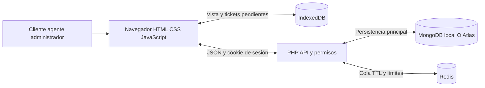

# Arquitectura v1

MongoDB mantiene documentos de negocio y auditoría; Redis acelera lecturas
temporales y cuenta intentos. Si Redis cae, se consulta MongoDB. La cola TTL
es de 15 segundos y se invalida por versión al cambiar tickets. Claves por
conexión, usuario y versión impiden mezclar alcances. El navegador guarda
nuevas solicitudes pendientes y vuelve a enviar cuando se recupera la red.
El servidor valida de nuevo y evita duplicar el identificador.

La sesión PHP usa el almacenamiento configurado por el servidor, no Redis
obligatoriamente. MongoDB local y Atlas son alternativas. No hay replicación
automática entre perfiles. No se usa SQLite: MongoDB y Redis resuelven las
dos responsabilidades elegidas. HTTPS y una visita previa son necesarios
para la continuidad con service worker fuera de localhost.
